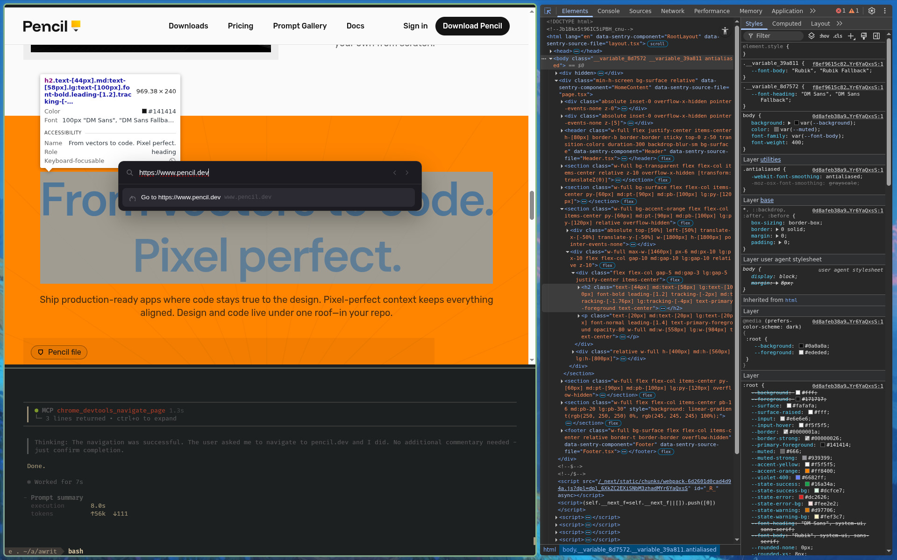

# Awrit 

> Fork of [`chase/awrit`](https://github.com/chase/awrit): Chromium in your [Kitty](https://sw.kovidgoyal.net/kitty/) terminal, which coding agents can see and drive.

## Features
- [x] Google Sign-In (GIS and direct sign-in)
- [x] 2-finger horizontal swipe for back/forward
- [x] Vim-style keyboard navigation
- [x] Per-site zoom (`Alt+-` / `Alt+=` / `Ctrl+0`)
- [x] Omnibox with search suggestions
- [x] Site permissions prompt (camera, mic, location)
- [x] Tabs and multiple windows (`Alt+T`)
- [x] System clipboard both ways (OSC 52 + bracketed paste)
- [x] XDG data and log paths (`~/.local/share/awrit`)
- [x] Find in page (`Alt+/`)
- [x] Click-to-copy and double/triple-click selection
- [x] Error pages for network failures and crashes
- [x] Link hover status
- [x] DevTools (`F12` / `Ctrl+Shift+I`) and CDP (`--debug-port=9222`, off by default)
- [x] Shared-memory, dirty-rect rendering with SIMD colour conversion
- [x] Tear-free synchronized output (mode 2026)
- [x] Agent browser tools: read, snapshot, click, type, scroll (`awrit tool list`)
- [x] Design mode: point at page elements and send notes to the agent (`Alt+D`)
- [x] Android via ADB (`awrit device --help`); managed emulators need Linux x86_64 with KVM
- [x] Remote browser over SSH, experimental (`awrit show URL --host HOST`)
- [x] Agent setup for Claude Code, Codex, OpenCode, Pi and more (`awrit setup`)
- [ ] Settings page
- [ ] History management
- [ ] Cookies and site data management



## Requirements

- Linux or macOS (x86_64, arm64)
- [Kitty](https://sw.kovidgoyal.net/kitty/)

## Install

```bash
curl -fsSL https://raw.githubusercontent.com/Creator54/awrit/electron/install.sh | sh
```

With Nix:

```bash
nix profile install github:creator54/awrit
```

From source:

```bash
git clone https://github.com/creator54/awrit.git
cd awrit && nix run .
```

## Usage

```bash
awrit https://example.com   # browse in the terminal
awrit setup                 # connect your coding agents (--uninstall to remove)
awrit show URL              # open a page beside the chat
awrit capture --json        # screenshot the page or device
awrit overlay               # live view over the chat; Escape returns
```

Agents control the browser through a local Unix socket (`awrit tool`). CDP is optional via `--debug-port`.

`awrit --help` lists all commands.

## Contributing

See [AGENTS.md](AGENTS.md).
